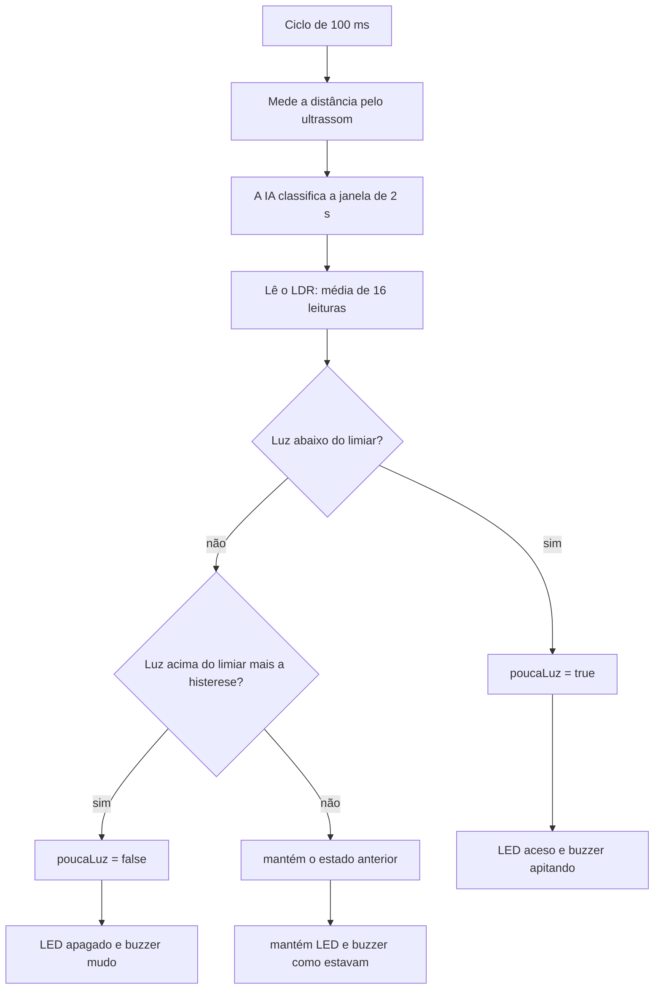

# 🔆 Documentação técnica — Módulo de luminosidade (LDR + LED vermelho + buzzer)

> Complemento da documentação existente do projeto **Little Mack** ([`README.md`](README.md) e [`Documentacao_Tecnica_Carro_Robo.md`](Documentacao_Tecnica_Carro_Robo.md)). Este documento descreve **apenas os componentes e o código adicionados** nesta evolução: o sensor de luminosidade (LDR), o LED vermelho e o buzzer.

## 📑 Sumário

1. [Visão geral](#1-visão-geral)
2. [Componentes novos](#2-componentes-novos)
3. [Ligações elétricas](#3-ligações-elétricas)
4. [Funcionamento do software](#4-funcionamento-do-software)
5. [Código-fonte completo](#5-código-fonte-completo)
6. [Treinamento do seu próprio modelo (Edge Impulse)](#6-treinamento-do-seu-próprio-modelo-edge-impulse)
7. [Instalação e execução](#7-instalação-e-execução)
8. [Calibração do sensor](#8-calibração-do-sensor)
9. [Testes de validação](#9-testes-de-validação)
10. [Solução de problemas](#10-solução-de-problemas)
11. [Limitações e melhorias futuras](#11-limitações-e-melhorias-futuras)
12. [Anexo: sketch de teste isolado](#12-anexo-sketch-de-teste-isolado)

---

## 1. Visão geral

O carrinho passou a monitorar a **luminosidade do ambiente**. Quando detecta **pouca luz**, ele emite um alerta visual (LED vermelho) e sonoro (buzzer). Quando a luz volta, o alerta é desligado.

A ideia parte do cenário de **iluminação e segurança em espaços públicos**: um robô que percorre ruas, praças ou pontos de ônibus e sinaliza áreas com iluminação insuficiente.

| Condição do ambiente | LED vermelho | Buzzer |
| :--- | :--- | :--- |
| Luz suficiente | Apagado | Mudo |
| Pouca luz | **Aceso** | **Apita** (150 ms ligado a cada 400 ms) |

**Pontos importantes desta versão:**

* O módulo de luminosidade roda **junto** com o controle Bluetooth (Dabble), o sensor ultrassônico e o modelo de TinyML, sem alterar nenhuma dessas funções.
* O alerta é **independente do movimento**: a pouca luz **não** bloqueia o carrinho nem aciona a manobra de ré. Ele só liga o LED e o buzzer. A integração com a ré está descrita como melhoria futura (seção 11).
* O LED e o buzzer continuam funcionando **durante a manobra autônoma** de ré e giro.

---

## 2. Componentes novos

### 2.1 Sensor de luminosidade (módulo LDR)

O **LDR** (*Light Dependent Resistor*, ou fotoresistor) é um componente cuja resistência elétrica **diminui quando a luz aumenta**. O ESP32 não lê resistência diretamente, só tensão. Por isso o LDR é ligado a um **divisor de tensão**, que transforma a variação de resistência em variação de tensão.

O projeto usa um **módulo** de sensor de luminosidade, em que o LDR e o resistor do divisor já estão montados na placa. Por isso **não é necessário resistor externo**.

* **Saída analógica (AO):** entrega uma tensão que varia com a luz. É a saída usada no projeto.
* **Saída digital (DO) e potenciômetro:** muitos módulos têm um comparador com um parafuso de ajuste que gera um sinal liga/desliga. **Não são usados** aqui. O parafuso azul não altera a leitura analógica.

| Característica | Valor |
| :--- | :--- |
| Tipo | Módulo sensor de luminosidade com LDR (saída analógica AO) |
| Modelo exato | [PREENCHER: marca/modelo do módulo] |
| Alimentação | **3,3 V** (pino 3V3 do ESP32) |
| Pino do ESP32 | **GPIO 34** (ADC1, canal 6, somente entrada) |
| Leitura | `analogRead()` de 12 bits: 0 a 4095 |
| Sentido da leitura | **Invertido** neste módulo: o valor **sobe** quando escurece |

**Cuidados:**
* Alimente o módulo com **3V3, nunca com 5V**. A saída AO pode chegar perto da tensão de alimentação, e o GPIO 34 do ESP32 não suporta 5 V.
* O GPIO 34 pertence ao **ADC1**, que pode ser usado normalmente junto com o Bluetooth. (O ADC2 é que tem restrições com Wi-Fi.)
* O GPIO 34 é **somente entrada**, o que é adequado para a leitura analógica.

### 2.2 LED vermelho

Indica **visualmente** que o ambiente está com pouca luz.

| Característica | Valor |
| :--- | :--- |
| Tipo | LED vermelho de 5 mm |
| Pino do ESP32 | **GPIO 18** (saída digital) |
| Resistor em série | **220 Ω** (obrigatório, para limitar a corrente) |
| Corrente aproximada | cerca de 6 mA (tensão direta ≈ 2,0 V com 3,3 V no pino) |
| Polaridade | perna longa (ânodo, +) para o resistor; perna curta (cátodo, −) para o GND |

### 2.3 Buzzer

Emite o alerta **sonoro** de pouca luz.

| Característica | Valor |
| :--- | :--- |
| Tipo | Buzzer **ativo** (tem oscilador interno: emite o tom quando recebe nível alto) |
| Modelo / tensão | [PREENCHER: modelo e tensão do buzzer usado] |
| Pino do ESP32 | **GPIO 19** (saída digital) |
| Nível de acionamento | `HIGH` liga e `LOW` desliga (constantes `BUZZER_ON` e `BUZZER_OFF`) |
| Padrão do alerta | 150 ms ligado a cada 400 ms (cerca de 2,5 bipes por segundo) |

**Observações:**
* Um buzzer **passivo** não toca com nível alto fixo: ele só faz "clique" e precisa de um sinal de frequência (PWM). Esta versão do código foi feita para buzzer **ativo**.
* Se o buzzer do seu módulo ligar com nível baixo, troque `BUZZER_ON` para `LOW` e `BUZZER_OFF` para `HIGH`.
* Buzzers que consomem mais de aproximadamente 20 mA devem ser acionados por um transistor NPN (2N2222 ou BC547) em vez de direto pelo pino.

---

## 3. Ligações elétricas

### 3.1 Mapa de pinos completo do ESP32

| Função | Componente | GPIO | Status |
| :--- | :--- | :---: | :--- |
| IN1 | Ponte H L298N | 27 | existente |
| IN2 | Ponte H L298N | 26 | existente |
| IN3 | Ponte H L298N | 25 | existente |
| IN4 | Ponte H L298N | 33 | existente |
| Trig | Ultrassônico HC-SR04 | 14 | existente |
| Echo | Ultrassônico HC-SR04 | 12 | existente |
| **AO (saída analógica)** | **Módulo LDR** | **34** | **novo** |
| **Saída digital** | **LED vermelho** | **18** | **novo** |
| **Saída digital** | **Buzzer** | **19** | **novo** |

Os pinos novos não conflitam com nenhum dos já utilizados.

### 3.2 Esquemas de ligação

**Módulo LDR**

| Pino do módulo | Liga em |
| :--- | :--- |
| VCC | 3V3 do ESP32 |
| GND | GND do ESP32 |
| AO | GPIO 34 |
| DO | não conectado |

**LED vermelho**

```
GPIO 18 ──[ 220 Ω ]──►|── GND
                   (ânodo, perna longa, do lado do resistor)
```

**Buzzer ativo**

```
GPIO 19 ──── (+) BUZZER (−) ──── GND
```

Se o buzzer for um módulo de 3 pinos, ligue S (ou I/O) no GPIO 19, VCC no 3V3 e GND no GND.

### 3.3 Regras gerais

* Todos os GND (ESP32, módulo LDR, LED, buzzer, ponte H e baterias) devem estar **interligados**.
* Faça as ligações com o carrinho **desligado** e sem o cabo USB.
* **Posição do LDR:** fixe o módulo virado para cima e sem sombra do próprio chassi, do porta-pilhas, dos fios ou da carenagem. A posição altera a leitura (veja a seção 8).

---

## 4. Funcionamento do software

### 4.1 Fluxo de decisão



### 4.2 Processamento da leitura

1. **Média de 16 leituras** do `analogRead`, espaçadas por `delay(2)` (cerca de 32 ms no total). Isso reduz o ruído e cobre mais de 3 ciclos da oscilação da iluminação de rede (120 Hz no Brasil).
2. **Correção do sentido:** como este módulo é invertido, `luz = 4095 − bruto`. Depois da correção, **quanto maior o valor, mais claro**.
3. **Histerese:** o alarme **liga** quando `luz < LIMIAR_ESCURO` e só **desliga** quando `luz > LIMIAR_ESCURO + HISTERESE`. Isso evita que o LED e o buzzer fiquem ligando e desligando quando a luz está perto do limite.

### 4.3 Parâmetros ajustáveis

| Constante | Valor | Descrição |
| :--- | :---: | :--- |
| `LDR_PIN` | 34 | Pino da saída analógica do módulo |
| `LED_PIN` | 18 | Pino do LED vermelho |
| `BUZZER_PIN` | 19 | Pino do buzzer |
| `LDR_INVERTIDO` | 1 | `1` se o valor sobe quando escurece (caso deste módulo) |
| `LIMIAR_ESCURO` | 1500 | Abaixo deste valor (já corrigido) há pouca luz. **Deve ser calibrado** |
| `HISTERESE` | 150 | Margem de desligamento do alarme |
| `BUZZER_ON` / `BUZZER_OFF` | `HIGH` / `LOW` | Nível que liga e desliga o buzzer |

### 4.4 Funções adicionadas ao firmware

| Função | Quando roda | O que faz |
| :--- | :--- | :--- |
| `atualizarLuz()` | Uma vez por ciclo de 100 ms | Lê o LDR, corrige o sentido, decide `poucaLuz` com histerese e imprime a leitura no Serial a cada 300 ms |
| `atualizarAlertas()` | A cada volta do `loop()` | Liga o LED e gera o padrão de bipes do buzzer conforme `poucaLuz` |

A leitura (`atualizarLuz`) fica dentro do ciclo de 100 ms que já existia, e o tempo dela (cerca de 32 ms) mais o da medição do ultrassom e da IA fica abaixo de 100 ms. Assim a amostragem do modelo de TinyML continua a **10 Hz**, a mesma usada no treinamento. Já `atualizarAlertas()` roda a cada volta do `loop()` para que o ritmo do bip fique correto e para que o alarme continue ativo durante a manobra de ré.

No `setup()`, o LED acende e o buzzer dá **um bip curto** na partida. Isso serve como autoteste da ligação dos dois.

### 4.5 Alterações em relação ao firmware anterior

| Parte do código | Alteração |
| :--- | :--- |
| Constantes | Novo bloco com os pinos e parâmetros do LDR, LED e buzzer |
| Variáveis globais | `bool poucaLuz` |
| `setup()` | Configuração dos três pinos e autoteste de partida |
| `loop()` | Duas chamadas: `atualizarLuz()` e `atualizarAlertas()` |
| Funções | `atualizarLuz()` e `atualizarAlertas()` |
| Demais lógica | **Sem alterações** (controle dos motores, ultrassom, IA, manobra autônoma e parada de emergência) |

---

## 5. Código-fonte completo

Arquivo sugerido no repositório: `firmware/carrinho_ia_ldr/carrinho_ia_ldr.ino` (na Arduino IDE, a pasta e o arquivo `.ino` precisam ter o mesmo nome). As linhas novas estão marcadas com `// LDR`.

> **Antes de compilar:** o firmware depende da biblioteca do Edge Impulse do **seu** modelo. Treine-o e instale-o seguindo a [seção 6](#6-treinamento-do-seu-próprio-modelo-edge-impulse) e ajuste a linha `#include <NOME_DO_SEU_PROJETO_inferencing.h>`.

```cpp
#include <DabbleESP32.h>
#include <NOME_DO_SEU_PROJETO_inferencing.h>   // gerado pelo Edge Impulse (veja a seção 6.6)

// ---- Motores ----
#define IN1 27
#define IN2 26
#define IN3 25
#define IN4 33

// ---- Sensor ----
#define TRIG_PIN 14
#define ECHO_PIN 12
#define DIST_MAX_CM 100
#define INTERVALO_MS 100
#define DISTANCIA_EMERGENCIA_CM 8

// ---- IA ----
#define CONFIANCA_MINIMA 0.70
#define CLASSIFICAR_A_CADA 5

// ---- Manobra autônoma ----
#define TEMPO_RE_MS 700
#define TEMPO_VIRAR_MS 500

// ---- LDR, LED vermelho e buzzer ---- // LDR
#define LDR_PIN 34
#define BUZZER_PIN 19
#define LED_PIN 18

#define LDR_INVERTIDO 1      // o módulo usado sobe no escuro
#define LIMIAR_ESCURO 1500   // abaixo disso = pouca luz (LED + buzzer). AJUSTE NA CALIBRAÇÃO
#define HISTERESE 150        // evita ligar e desligar no limite

#define BUZZER_ON  HIGH      // troque para LOW se o módulo apitar com nível baixo
#define BUZZER_OFF LOW

enum EstadoManobra { MANOBRA_NENHUMA, MANOBRA_RE, MANOBRA_VIRAR };

static float features[EI_CLASSIFIER_DSP_INPUT_FRAME_SIZE];
int amostrasColetadas = 0;
int contadorClassificacao = 0;
bool bloquearFrente = false;
String classeAtual = "";

EstadoManobra estadoManobra = MANOBRA_NENHUMA;
unsigned long inicioManobra = 0;
bool virarParaEsquerda = true;
bool aguardarSoltarFrente = false;

bool poucaLuz = false;   // LDR

void moveForward();
void moveBackward();
void turnLeft();
void turnRight();
void stopMotors();
float medirDistanciaCm();
void classificar();
void iniciarManobra();
void executarManobra();
void atualizarLuz();      // LDR
void atualizarAlertas();  // LDR

int ei_get_data(size_t offset, size_t length, float *out_ptr) {
    memcpy(out_ptr, features + offset, length * sizeof(float));
    return 0;
}

void setup() {
    Serial.begin(115200);

    pinMode(IN1, OUTPUT);
    pinMode(IN2, OUTPUT);
    pinMode(IN3, OUTPUT);
    pinMode(IN4, OUTPUT);
    pinMode(TRIG_PIN, OUTPUT);
    pinMode(ECHO_PIN, INPUT);

    // ---- LDR, buzzer e LED vermelho ---- // LDR
    pinMode(LDR_PIN, INPUT);

    digitalWrite(BUZZER_PIN, BUZZER_OFF);
    pinMode(BUZZER_PIN, OUTPUT);
    digitalWrite(LED_PIN, LOW);
    pinMode(LED_PIN, OUTPUT);

    // Teste na partida: LED aceso e um bip curto
    digitalWrite(LED_PIN, HIGH);
    digitalWrite(BUZZER_PIN, BUZZER_ON);
    delay(150);
    digitalWrite(BUZZER_PIN, BUZZER_OFF);
    delay(150);
    digitalWrite(LED_PIN, LOW);

    Serial.println("Teste LDR + buzzer + LED vermelho");

    Dabble.begin("HAREP");
}

void loop() {
    Dabble.processInput();

    // 1) Amostragem não bloqueante a 10 Hz com janela deslizante
    static unsigned long ultimo = 0;
    static float distanciaAtual = DIST_MAX_CM;

    if (millis() - ultimo >= INTERVALO_MS) {
        ultimo = millis();
        distanciaAtual = medirDistanciaCm();

        if (amostrasColetadas < EI_CLASSIFIER_DSP_INPUT_FRAME_SIZE) {
            features[amostrasColetadas++] = distanciaAtual;
        } else {
            memmove(features, features + 1,
                    (EI_CLASSIFIER_DSP_INPUT_FRAME_SIZE - 1) * sizeof(float));
            features[EI_CLASSIFIER_DSP_INPUT_FRAME_SIZE - 1] = distanciaAtual;
        }

        // 2) Janela cheia: classifica periodicamente
        if (amostrasColetadas == EI_CLASSIFIER_DSP_INPUT_FRAME_SIZE) {
            contadorClassificacao++;
            if (contadorClassificacao >= CLASSIFICAR_A_CADA) {
                contadorClassificacao = 0;
                classificar();
            }
        }

        atualizarLuz();   // LDR: lê o sensor de luz na mesma cadência de 10 Hz
    }

    atualizarAlertas();   // LDR: LED e buzzer (também durante a manobra)

    // 3) Segurança: parada de emergência por distância
    bool emergencia = (distanciaAtual <= DISTANCIA_EMERGENCIA_CM);
    bool frenteBloqueada = bloquearFrente || emergencia;

    // Manobra em andamento -> ignora o GamePad até terminar
    if (estadoManobra != MANOBRA_NENHUMA) {
        executarManobra();
        return;
    }

    // Após a manobra, exige soltar o botão "frente" antes de voltar a andar
    if (aguardarSoltarFrente && !GamePad.isUpPressed()) {
        aguardarSoltarFrente = false;
    }

    // 4) Controle
    if (GamePad.isUpPressed()) {
        if (aguardarSoltarFrente) {
            stopMotors();
        }
        else if (frenteBloqueada) {
            iniciarManobra();   // em vez de só parar, inicia a manobra
        }
        else {
            moveForward();
        }
    }
    else if (GamePad.isDownPressed()) {
        moveBackward();
    }
    else if (GamePad.isLeftPressed()) {
        turnLeft();
    }
    else if (GamePad.isRightPressed()) {
        turnRight();
    }
    else {
        stopMotors();
    }
}

// LDR: lê o sensor, calcula a luz e decide se há pouca luz (com histerese)
void atualizarLuz() {
    // Média de 16 leituras para reduzir ruído (0 a 4095)
    long soma = 0;
    for (int i = 0; i < 16; i++) {
        soma += analogRead(LDR_PIN);
        delay(2);
    }
    int bruto = soma / 16;
    int luz = LDR_INVERTIDO ? 4095 - bruto : bruto;   // quanto maior, mais claro

    // Decide se está com pouca luz (com histerese)
    if (!poucaLuz && luz < LIMIAR_ESCURO) {
        poucaLuz = true;
    } else if (poucaLuz && luz > LIMIAR_ESCURO + HISTERESE) {
        poucaLuz = false;
    }

    // Mostra no Serial Monitor a cada 300 ms
    static unsigned long ultimoPrint = 0;
    if (millis() - ultimoPrint >= 300) {
        ultimoPrint = millis();
        Serial.printf("Bruto: %4d | Luz: %4d | %s\n",
                      bruto, luz, poucaLuz ? "POUCA LUZ (LED + buzzer)" : "claro");
    }
}

// LDR: LED vermelho e buzzer enquanto estiver com pouca luz
void atualizarAlertas() {
    // LED vermelho: aceso enquanto estiver com pouca luz
    digitalWrite(LED_PIN, poucaLuz ? HIGH : LOW);

    // Buzzer: apita (150 ms ligado a cada 400 ms) enquanto estiver com pouca luz
    if (poucaLuz) {
        digitalWrite(BUZZER_PIN, (millis() % 400) < 150 ? BUZZER_ON : BUZZER_OFF);
    } else {
        digitalWrite(BUZZER_PIN, BUZZER_OFF);
    }
}

void iniciarManobra() {
    estadoManobra = MANOBRA_RE;
    inicioManobra = millis();
    moveBackward();
    Serial.println("Manobra: dando re");
}

void executarManobra() {
    unsigned long decorrido = millis() - inicioManobra;

    if (estadoManobra == MANOBRA_RE) {
        if (decorrido >= TEMPO_RE_MS) {
            estadoManobra = MANOBRA_VIRAR;
            inicioManobra = millis();
            if (virarParaEsquerda) turnLeft(); else turnRight();
            virarParaEsquerda = !virarParaEsquerda;  // alterna o lado a cada manobra
            Serial.println("Manobra: virando");
        }
    }
    else if (estadoManobra == MANOBRA_VIRAR) {
        if (decorrido >= TEMPO_VIRAR_MS) {
            stopMotors();
            estadoManobra = MANOBRA_NENHUMA;

            // Descarta a janela antiga (ela ainda diz "obstáculo") e recomeça a coletar
            amostrasColetadas = 0;
            contadorClassificacao = 0;
            bloquearFrente = false;
            classeAtual = "";

            aguardarSoltarFrente = true;
            Serial.println("Manobra concluida: controles liberados");
        }
    }
}

void classificar() {
    signal_t signal;
    signal.total_length = EI_CLASSIFIER_DSP_INPUT_FRAME_SIZE;
    signal.get_data = &ei_get_data;

    ei_impulse_result_t result;
    EI_IMPULSE_ERROR erro = run_classifier(&signal, &result, false);
    if (erro != EI_IMPULSE_OK) {
        Serial.printf("Erro na inferencia: %d\n", erro);
        return;
    }

    float melhorValor = 0;
    String melhorClasse = "";
    for (size_t i = 0; i < EI_CLASSIFIER_LABEL_COUNT; i++) {
        if (result.classification[i].value > melhorValor) {
            melhorValor = result.classification[i].value;
            melhorClasse = result.classification[i].label;
        }
    }

    if (melhorValor >= CONFIANCA_MINIMA) {
        classeAtual = melhorClasse;
        bloquearFrente = (classeAtual == "aproximando" ||
                          classeAtual == "proximo_parado");
    }

    Serial.printf("Classe: %s (%.2f) | frente bloqueada: %d\n",
                  classeAtual.c_str(), melhorValor, bloquearFrente);
}

float medirDistanciaCm() {
    digitalWrite(TRIG_PIN, LOW);
    delayMicroseconds(2);
    digitalWrite(TRIG_PIN, HIGH);
    delayMicroseconds(10);
    digitalWrite(TRIG_PIN, LOW);

    long duracao = pulseIn(ECHO_PIN, HIGH, 30000);
    if (duracao == 0) return DIST_MAX_CM;

    float cm = duracao * 0.0343 / 2.0;
    if (cm > DIST_MAX_CM) cm = DIST_MAX_CM;
    return cm;
}

void moveForward() {
    digitalWrite(IN1, HIGH); digitalWrite(IN2, LOW);
    digitalWrite(IN3, HIGH); digitalWrite(IN4, LOW);
}

void moveBackward() {
    digitalWrite(IN1, LOW);  digitalWrite(IN2, HIGH);
    digitalWrite(IN3, LOW);  digitalWrite(IN4, HIGH);
}

void turnLeft() {
    digitalWrite(IN1, LOW);  digitalWrite(IN2, HIGH);
    digitalWrite(IN3, HIGH); digitalWrite(IN4, LOW);
}

void turnRight() {
    digitalWrite(IN1, HIGH); digitalWrite(IN2, LOW);
    digitalWrite(IN3, LOW);  digitalWrite(IN4, HIGH);
}

void stopMotors() {
    digitalWrite(IN1, LOW); digitalWrite(IN2, LOW);
    digitalWrite(IN3, LOW); digitalWrite(IN4, LOW);
}
```

---

## 6. Treinamento do seu próprio modelo (Edge Impulse)

O firmware usa um modelo de **TinyML** treinado no [Edge Impulse](https://edgeimpulse.com) para classificar o comportamento do obstáculo à frente do carrinho (a parte de ultrassom e IA que já existia no projeto). **O modelo treinado pela equipe não é distribuído neste repositório.** Cada pessoa treina o seu com o sensor ultrassônico do próprio carrinho, porque as medições dependem do sensor, do local e dos objetos usados. Esta seção ensina o processo completo, do zero.

> Tempo estimado: de 30 a 60 minutos de coleta e alguns minutos de treinamento. Não é preciso conhecimento prévio de Machine Learning.

### 6.1 Visão geral do processo

```
Firmware de coleta → Script Python → CSVs → Edge Impulse → Treinamento → Biblioteca Arduino → Firmware do carrinho
```

### 6.2 O que o modelo classifica

O modelo olha uma **janela de 2 segundos** de leituras de distância e responde qual destas situações está acontecendo:

| Classe | Situação | Ação do carrinho |
| :--- | :--- | :--- |
| `livre` | Nenhum obstáculo à frente (ou muito distante) | Anda normalmente |
| `aproximando` | Obstáculo vindo em direção ao sensor | Bloqueia o "frente" e faz a manobra |
| `proximo_parado` | Obstáculo parado a curta distância | Bloqueia o "frente" e faz a manobra |
| `afastando` | Obstáculo se afastando do sensor | Movimento liberado |

> **Use exatamente estes nomes de classe.** O firmware compara o texto `"aproximando"` e `"proximo_parado"` em `classificar()`. Se você renomear as classes, altere também essa comparação no código.

### 6.3 Pré-requisitos

* Conta gratuita no [Edge Impulse](https://edgeimpulse.com).
* Carrinho montado com o ultrassônico HC-SR04 (Trig no GPIO 14 e Echo no GPIO 12) e a Arduino IDE configurada (seção 7).
* Python 3 com a biblioteca `pyserial`: `pip install pyserial`.

### 6.4 Coleta de dados

**Passo 1. Gravar o firmware de coleta.** Ele mede a distância a cada 100 ms (10 Hz) e imprime o valor na Serial. A função de medição é a **mesma** do firmware final (limite de 100 cm; sem eco vale 100 cm). Isso é essencial: se a coleta e a inferência medirem de formas diferentes, o modelo não funciona no carrinho.

Depois de gravar, abra o Serial Monitor (115200) para conferir se os números mudam quando você passa a mão na frente do sensor. **Feche o Serial Monitor** antes de rodar o script, senão ele ocupa a porta.

<details>
<summary>Ver firmware de coleta (<code>firmware/coleta/coleta.ino</code>)</summary>

```cpp
#define TRIG_PIN 14
#define ECHO_PIN 12
#define DIST_MAX_CM 100
#define INTERVALO_MS 100   // 10 Hz

float medirDistanciaCm() {
    digitalWrite(TRIG_PIN, LOW);
    delayMicroseconds(2);
    digitalWrite(TRIG_PIN, HIGH);
    delayMicroseconds(10);
    digitalWrite(TRIG_PIN, LOW);

    long duracao = pulseIn(ECHO_PIN, HIGH, 30000);
    if (duracao == 0) return DIST_MAX_CM;

    float cm = duracao * 0.0343 / 2.0;
    if (cm > DIST_MAX_CM) cm = DIST_MAX_CM;
    return cm;
}

void setup() {
    Serial.begin(115200);
    pinMode(TRIG_PIN, OUTPUT);
    pinMode(ECHO_PIN, INPUT);
}

void loop() {
    static unsigned long ultimo = 0;
    if (millis() - ultimo >= INTERVALO_MS) {
        ultimo = millis();
        Serial.println(medirDistanciaCm());
    }
}
```

</details>

**Passo 2. Salvar as medições em CSV.** O script lê a Serial por 15 segundos e grava um arquivo `dataset/<classe>.<número>.csv`, com as colunas `timestamp` (ms) e `dist` (cm), que é o formato aceito pelo Edge Impulse.

<details>
<summary>Ver script Python (<code>coleta/coletar.py</code>)</summary>

```python
import serial, time, sys, os

PORTA = "COM3"          # troque pela porta do seu ESP32
DURACAO_S = 15          # duração de cada amostra
classe = sys.argv[1]    # ex: python coletar.py aproximando

os.makedirs("dataset", exist_ok=True)
n = len([f for f in os.listdir("dataset") if f.startswith(classe)]) + 1
arquivo = f"dataset/{classe}.{n:02d}.csv"

ser = serial.Serial(PORTA, 115200, timeout=1)
time.sleep(2)
ser.reset_input_buffer()

print(f"Coletando '{classe}' por {DURACAO_S}s... comece o movimento!")
inicio = time.time()
with open(arquivo, "w") as f:
    f.write("timestamp,dist\n")
    while time.time() - inicio < DURACAO_S:
        linha = ser.readline().decode(errors="ignore").strip()
        try:
            valor = float(linha)
        except ValueError:
            continue
        ms = int((time.time() - inicio) * 1000)
        f.write(f"{ms},{valor}\n")
print("Salvo em", arquivo)
```

</details>

**Passo 3. Coletar cada classe.** Troque `PORTA` pela porta COM do seu ESP32 e rode o script uma vez por amostra, informando a classe:

```bash
python coletar.py livre
python coletar.py aproximando
python coletar.py proximo_parado
python coletar.py afastando
```

Durante os 15 segundos de cada execução, faça o movimento correspondente na frente do sensor:

| Classe | O que fazer durante a coleta |
| :--- | :--- |
| `livre` | Deixe o sensor apontado para um espaço vazio ou para um objeto a mais de 1 m |
| `aproximando` | Leve a mão ou uma caixa de longe (cerca de 1 m) até perto (cerca de 10 cm), várias vezes |
| `proximo_parado` | Mantenha um objeto parado entre 10 e 30 cm do sensor, sem mexer |
| `afastando` | Parta de perto (cerca de 10 cm) e afaste o objeto até cerca de 1 m, várias vezes |

**Recomendações:**
* No mínimo **10 arquivos de 15 s por classe**. Quanto mais variedade, melhor: mude a velocidade, o objeto, a distância e a posição do carrinho.
* Colete também com o carrinho **empurrado devagar** na direção de uma parede, que é a situação real de uso.
* Como referência, o modelo da equipe foi treinado com cerca de 16 minutos de dados no total.

### 6.5 Treinamento no Edge Impulse

1. **Criar o projeto.** No Edge Impulse, crie um projeto novo. **O nome do projeto define o nome da biblioteca** que você vai instalar (seção 6.6).
2. **Enviar os dados.** Vá em *Data acquisition → Add data → Upload data*. Selecione **os arquivos de uma classe por vez**, em *Label* escolha **Enter label** e digite o nome exato da classe. Em *Upload into category*, deixe **Automatically split between training and testing**. Repita para as 4 classes. No primeiro envio, o assistente de CSV pede os campos: série temporal, coluna de tempo `timestamp` e valor `dist` (cerca de 10 Hz).
   > **Não use "Infer from filename".** Na experiência da equipe, essa opção não leu os nomes e todas as amostras ficaram com um único label, o que fez o treinamento falhar. Se isso acontecer, apague os dados e reenvie com o label digitado.
3. **Conferir os dados.** Em *Data acquisition*, confirme que existem as **4 classes** e que a divisão treino/teste está em torno de 80% / 20%.
4. **Criar o Impulse.** Em *Create impulse*, configure:

   | Parâmetro | Valor |
   | :--- | :--- |
   | Tipo de dado | Time series data (eixo `dist`) |
   | Window size | **2000 ms** |
   | Window increase | **200 ms** |
   | Frequency | **10 Hz** |
   | Processing block | **Flatten** |
   | Learning block | **Classification** |

   Clique em *Save Impulse*.
5. **Gerar as features.** Na aba *Flatten*, clique em *Generate features*. No *Feature explorer* você deve ver as 4 classes em cores diferentes.
6. **Treinar.** Na aba *Classifier*, mantenha os valores padrão e clique em *Start training*.
7. **Avaliar.** Veja a acurácia e a **matriz de confusão**. Depois, em *Model testing*, clique em **Classify all** para medir o desempenho com dados que o modelo nunca viu.
8. **Exportar.** Em *Deployment*, escolha **Arduino library**, mantenha a otimização **Quantized (int8)** (a mais leve para o ESP32), clique em *Build* e baixe o `.zip`.

**Resultado de referência (modelo da equipe):** acurácia de 64,7% na validação e de 25,38% no teste, com `livre` e `proximo_parado` bem reconhecidas e confusão entre `aproximando` e `afastando`. Isso acontece porque o bloco Flatten usa média, mínimo e máximo, que não dependem da **ordem** das leituras. Para melhorar, teste o bloco **Raw data** no lugar do Flatten, ou colete mais dados.

### 6.6 Instalar a biblioteca e apontar o firmware

1. Na Arduino IDE: *Sketch → Include Library → Add .ZIP Library* e escolha o `.zip` baixado.
2. O cabeçalho da biblioteca tem o nome do **seu projeto** do Edge Impulse seguido de `_inferencing.h` (por exemplo, um projeto chamado `meu-carrinho` gera `meu-carrinho_inferencing.h`).
3. No firmware (seção 5), troque a linha do placeholder pelo `#include` da sua biblioteca. O jeito mais seguro é usar *Sketch → Include Library →* (nome da sua biblioteca), que insere o `#include` correto no topo do sketch. Depois, apague a linha `#include <NOME_DO_SEU_PROJETO_inferencing.h>`.
4. Compile. Sem a biblioteca instalada, o compilador mostra o erro `No such file or directory` nessa linha.

### 6.7 Parâmetros que precisam combinar

O firmware e o Impulse precisam usar os mesmos valores. Se você mudar um lado, ajuste o outro.

| No Edge Impulse | No firmware | Valor padrão |
| :--- | :--- | :---: |
| Frequency | `INTERVALO_MS` (intervalo entre leituras) | 10 Hz = `100` |
| Window size | Tamanho da janela (`EI_CLASSIFIER_DSP_INPUT_FRAME_SIZE`, definido pela biblioteca) | 2000 ms = 20 leituras |
| Limite de distância usado nos dados | `DIST_MAX_CM` | `100` |
| Nomes das classes | Comparação em `classificar()` | `aproximando`, `proximo_parado` |
| (ajuste do firmware) | `CONFIANCA_MINIMA` | `0.70` |
| (ajuste do firmware) | `CLASSIFICAR_A_CADA` (leituras entre classificações) | `5` |

### 6.8 Problemas comuns no treinamento

| Sintoma | Causa provável | O que fazer |
| :--- | :--- | :--- |
| O treinamento falha e o Feature explorer tem uma só cor | Todas as amostras ficaram com um único label (*Infer from filename*) | Apague os dados e reenvie cada classe com o label digitado |
| Acurácia baixa entre `aproximando` e `afastando` | O Flatten não guarda a ordem das leituras | Teste o bloco Raw data e colete mais amostras |
| Acurácia de teste bem menor que a de validação | A validação usa janelas sobrepostas do mesmo arquivo, e amostras de teste sem label não são pontuadas | Confira os labels em *Data acquisition* e rode *Classify all* de novo |
| Muitas janelas *uncertain* | Nenhuma classe atinge o limiar de confiança | Colete mais dados e com mais variedade |
| Funciona no Edge Impulse, mas não no carrinho | Frequência ou limite de distância diferentes entre coleta e firmware | Confira a tabela da seção 6.7 e a posição do sensor |
| `No such file or directory` ao compilar | Biblioteca não instalada, ou nome do `#include` diferente do nome do projeto | Reinstale o `.zip` e use *Sketch → Include Library* para inserir o `#include` |

---

## 7. Instalação e execução

### 6.1 Requisitos

| Item | Versão / detalhe |
| :--- | :--- |
| Arduino IDE | 2.3.x |
| Core **esp32** (Espressif Systems) | **2.0.14** (não atualizar para a série 3.x) |
| Biblioteca **DabbleESP32** (STEMpedia) | **1.5.x** (a série 1.6.x é escrita para o core 3.x e não compila com o 2.0.14) |
| Biblioteca do Edge Impulse | Gerada a partir do **seu** modelo treinado (seção 6) e instalada por `.zip` |
| Placa | ESP32 Dev Module |
| Aplicativo no celular | **Dabble** (módulo GamePad) |

### 6.2 Passo a passo

1. **Clonar o repositório**
   ```bash
   git clone https://github.com/HLima214/Carro_Robo.git
   ```
2. **Instalar o core esp32 2.0.14:** *Tools → Board → Boards Manager*, buscar `esp32` (Espressif Systems), escolher a versão **2.0.14** e instalar.
3. **Instalar a DabbleESP32 1.5.x:** *Library Manager*, buscar `DabbleESP32`, selecionar uma versão **1.5.x** no menu de versões e instalar.
4. **Treinar o seu modelo e instalar a biblioteca dele:** siga a [seção 6](#6-treinamento-do-seu-próprio-modelo-edge-impulse). Ao final, instale o `.zip` exportado e ajuste a linha `#include` do firmware (seção 6.6).
5. **Montar os componentes** conforme a [seção 3](#3-ligações-elétricas), com o carrinho desligado.
6. **Configurar a IDE** em *Tools*:
   * Board: **ESP32 Dev Module**
   * Port: a porta COM do ESP32
   * Partition Scheme: **Huge APP (3MB No OTA/1MB SPIFFS)** (recomendado, para dar folga de memória)
   * Upload Speed: **115200** (recomendado, para evitar falhas de gravação)
7. **Calibrar o sensor** seguindo a [seção 8](#8-calibração-do-sensor) e ajustar `LIMIAR_ESCURO` (e `LDR_INVERTIDO`, se necessário) no código.
8. **Compilar e gravar** o sketch. Durante a gravação, mantenha o ESP32 alimentado **somente pelo USB** (desligue as pilhas/bateria e o fio de 5V vindo da ponte H).
9. **Abrir o Serial Monitor** em **115200 baud**. A cada 300 ms aparece a leitura do sensor de luz, e a cada 0,5 s a classe da IA.
10. **Conectar o Dabble:** no aplicativo, buscar o dispositivo Bluetooth **HAREP**, conectar e abrir o módulo **GamePad**.

### 6.3 Execução

Na partida, o **LED acende e o buzzer dá um bip curto**, confirmando as ligações. Depois disso:

* Com luz suficiente, o LED fica apagado e o buzzer mudo.
* Com pouca luz, o LED acende e o buzzer apita até a luz voltar.
* O controle pelo Dabble, o ultrassom e a IA funcionam como antes, independentemente do alarme.

**Uso de memória (compilação com a partição padrão):** o firmware ocupa **1.200.005 bytes (91%)** dos 1.310.720 bytes disponíveis e usa **42.716 bytes (13%)** de memória dinâmica. Cabe na partição padrão, mas com pouca folga. A partição *Huge APP* é recomendada para dar margem a futuras alterações.

---

## 8. Calibração do sensor

A leitura depende do módulo, da posição em que ele fica no carrinho e da iluminação do local. Por isso o `LIMIAR_ESCURO` **precisa ser calibrado** no local e na posição finais.

**Procedimento:**

1. Com o sketch de teste do [Anexo](#12-anexo-sketch-de-teste-isolado) (ou o próprio firmware), abra o Serial Monitor.
2. Com o carrinho **montado e no local de uso**, anote a coluna `Bruto` em três situações: luz normal do ambiente, lanterna do celular perto do sensor e sensor totalmente coberto.
3. Veja o sentido: se o `Bruto` **sobe** quando cobre o sensor, o módulo é invertido e `LDR_INVERTIDO` deve ser `1`.
4. Converta para a escala corrigida (`luz = 4095 − bruto`, se invertido).
5. Escolha o `LIMIAR_ESCURO` **entre** o valor da luz normal e o do sensor coberto. Quanto mais perto da luz normal, mais cedo o alarme dispara.

**Exemplo da calibração realizada pela equipe:**

| Situação | Bruto | Luz (`4095 − bruto`) |
| :--- | :---: | :---: |
| Ambiente, em bancada (primeira calibração) | ~1420 | ~2675 |
| Sensor coberto, em bancada | ~3500 | ~590 |
| Luz normal, com o sensor montado no carrinho | ~2275 | ~1820 |

Na primeira calibração o limiar era 2000. Depois de montar o sensor no carrinho, a leitura em luz normal caiu para cerca de 1820 (o sensor ficou mais sombreado), o que fazia o alarme disparar com luz normal. O limiar foi então ajustado para **1500**: o alarme liga abaixo de 1500 e só desliga acima de 1650, o que mantém a luz normal (~1820) sem alarme e o sensor coberto (~590) com alarme. **Isso mostra por que a calibração deve ser refeita sempre que a posição do sensor ou o local mudar.**

---

## 9. Testes de validação

| # | Teste | Resultado esperado | Status |
| :---: | :--- | :--- | :---: |
| 1 | Energizar o carrinho | LED acende e o buzzer dá um bip curto na partida | ☐ |
| 2 | Luz normal | LED apagado, buzzer mudo, Serial mostra `claro` | ☐ |
| 3 | Cobrir o sensor | LED acende, buzzer apita, Serial mostra `POUCA LUZ (LED + buzzer)` | ☐ |
| 4 | Descobrir o sensor | LED e buzzer desligam quando `Luz` passa de `LIMIAR_ESCURO + HISTERESE` | ☐ |
| 5 | Lanterna do celular no sensor | Alarme permanece desligado | ☐ |
| 6 | Sombra parcial (mão em concha) | Alarme liga ou não, conforme o limiar calibrado | ☐ |
| 7 | Controle pelo Dabble com o alarme ligado | O carrinho responde normalmente (o alarme não interfere nos motores) | ☐ |
| 8 | Manobra de ré e giro com o alarme ligado | Manobra completa e o LED e o buzzer continuam ativos | ☐ |
| 9 | IA e ultrassom | Classificação e bloqueio do "frente" funcionam como antes | ☐ |

---

## 10. Solução de problemas

| Sintoma | Causa provável | O que fazer |
| :--- | :--- | :--- |
| LED e buzzer ligados com luz normal | Limiar desalinhado, ou sensor na sombra do chassi, fios ou carenagem | Reposicione o sensor (virado para cima) e refaça a [calibração](#8-calibração-do-sensor) |
| Alarme dispara com luz e cala no escuro | Leitura invertida | Altere `LDR_INVERTIDO` (`1` ↔ `0`) |
| `Bruto` sempre 0 | VCC, GND ou AO soltos | Confira os fios do módulo |
| Só aparecem valores perto de 0 e 4095 | Fio do GPIO 34 está no **DO** em vez do **AO** | Passe o fio para o AO |
| Valores oscilando muito | Mau contato no GND ou no AO | Reencaixe os fios |
| LED não acende, nem na partida | Perna invertida, resistor ausente ou fio solto no GPIO 18 | A perna longa vai no resistor |
| Buzzer só faz "clique" | Buzzer **passivo** | Use um buzzer ativo, ou adapte o código para gerar tom por PWM |
| Buzzer apita direto, sem parar | Módulo que ativa com nível baixo | Troque `BUZZER_ON` para `LOW` e `BUZZER_OFF` para `HIGH` |
| Som fraco ou o ESP32 reinicia ao apitar | Buzzer puxa corrente demais do pino | Acione-o por um transistor NPN (2N2222 ou BC547) |
| Erro no upload: `Packet content transfer stopped` ou `Failed to communicate with the flash chip` | Velocidade de upload alta, cabo ruim ou alimentação dupla (USB e bateria) | Use Upload Speed 115200, troque o cabo, desligue as baterias e o 5V da ponte H durante a gravação. Se persistir, tire temporariamente o fio do Echo (GPIO 12) |
| Erro de compilação com `ledcAttachPin`, `ledcSetup` ou `ledcAttachChannel` | Core ou biblioteca Dabble em versões incompatíveis | Use o core **2.0.14** com a DabbleESP32 **1.5.x** |
| `No such file or directory` ao compilar | Biblioteca do Edge Impulse não instalada, ou `#include` ainda com o nome do placeholder | Treine e instale o seu modelo e ajuste o `#include` (seção 6.6) |

---

## 11. Limitações e melhorias futuras

* **O alarme não afeta os motores.** Para o escuro também acionar a manobra de ré, basta somar `poucaLuz` à condição de bloqueio, em `loop()`:
  ```cpp
  bool frenteBloqueada = bloquearFrente || emergencia || poucaLuz;
  ```
  Com isso, o carrinho não avança enquanto estiver com pouca luz e executa a manobra ao tentar ir para frente. Está **fora** desta versão.
* **Limiar fixo.** A detecção usa um limiar calibrado manualmente. Uma evolução é treinar um **segundo modelo no Edge Impulse** com leituras do LDR (claro, pouca luz, escuro), no mesmo fluxo de coleta em CSV já usado no projeto, para a IA classificar a iluminação.
* **Sem registro persistente.** Os dados de luminosidade só aparecem no Serial Monitor. Uma melhoria é gerar relatórios por local (por exemplo, enviando os dados por Wi-Fi ou salvando em cartão SD), alinhada à ideia original de apoiar a manutenção de iluminação pública.
* **Sensibilidade à posição.** O módulo é sensível à sombra do próprio carrinho. Com a carenagem, deixe o sensor exposto por um furo no topo.
* **Um único ponto de medição.** A leitura representa a luz no ponto do sensor, e não da área inteira.

---

## 12. Anexo: sketch de teste isolado

Sketch usado para testar e calibrar o LDR, o LED e o buzzer **separadamente do carrinho** (sem Dabble, motores, ultrassom nem IA). Ele serve também para medir os valores da [calibração](#8-calibração-do-sensor).

<details>
<summary>Ver código do sketch de teste</summary>

```cpp
#define LDR_PIN 34
#define BUZZER_PIN 19
#define LED_PIN 18

#define LDR_INVERTIDO 1      // o módulo usado sobe no escuro
#define LIMIAR_ESCURO 1500   // abaixo disso = pouca luz (LED + buzzer)
#define HISTERESE 150        // evita ligar e desligar no limite

#define BUZZER_ON  HIGH      // troque para LOW se o módulo apitar com nível baixo
#define BUZZER_OFF LOW

bool poucaLuz = false;

void setup() {
    Serial.begin(115200);
    pinMode(LDR_PIN, INPUT);

    digitalWrite(BUZZER_PIN, BUZZER_OFF);
    pinMode(BUZZER_PIN, OUTPUT);
    digitalWrite(LED_PIN, LOW);
    pinMode(LED_PIN, OUTPUT);

    // Teste na partida: LED aceso e um bip curto
    digitalWrite(LED_PIN, HIGH);
    digitalWrite(BUZZER_PIN, BUZZER_ON);
    delay(150);
    digitalWrite(BUZZER_PIN, BUZZER_OFF);
    delay(150);
    digitalWrite(LED_PIN, LOW);

    Serial.println("Teste LDR + buzzer + LED vermelho");
}

void loop() {
    // Média de 16 leituras para reduzir ruído (0 a 4095)
    long soma = 0;
    for (int i = 0; i < 16; i++) {
        soma += analogRead(LDR_PIN);
        delay(2);
    }
    int bruto = soma / 16;
    int luz = LDR_INVERTIDO ? 4095 - bruto : bruto;   // quanto maior, mais claro

    // Decide se está com pouca luz (com histerese)
    if (!poucaLuz && luz < LIMIAR_ESCURO) {
        poucaLuz = true;
    } else if (poucaLuz && luz > LIMIAR_ESCURO + HISTERESE) {
        poucaLuz = false;
    }

    // LED vermelho: aceso enquanto estiver com pouca luz
    digitalWrite(LED_PIN, poucaLuz ? HIGH : LOW);

    // Buzzer: apita (150 ms ligado a cada 400 ms) enquanto estiver com pouca luz
    if (poucaLuz) {
        digitalWrite(BUZZER_PIN, (millis() % 400) < 150 ? BUZZER_ON : BUZZER_OFF);
    } else {
        digitalWrite(BUZZER_PIN, BUZZER_OFF);
    }

    // Mostra no Serial Monitor a cada 300 ms
    static unsigned long ultimoPrint = 0;
    if (millis() - ultimoPrint >= 300) {
        ultimoPrint = millis();
        Serial.printf("Bruto: %4d | Luz: %4d | %s\n",
                      bruto, luz, poucaLuz ? "POUCA LUZ (LED + buzzer)" : "claro");
    }
}
```

</details>

---

## 📂 Arquivos adicionados ao repositório

| Arquivo/Pasta | Descrição |
| :--- | :--- |
| `Documentacao_Tecnica_LDR_Buzzer_LED.md` | Este documento |
| `firmware/carrinho_ia_ldr/carrinho_ia_ldr.ino` | Firmware completo do carrinho com o módulo de luminosidade |
